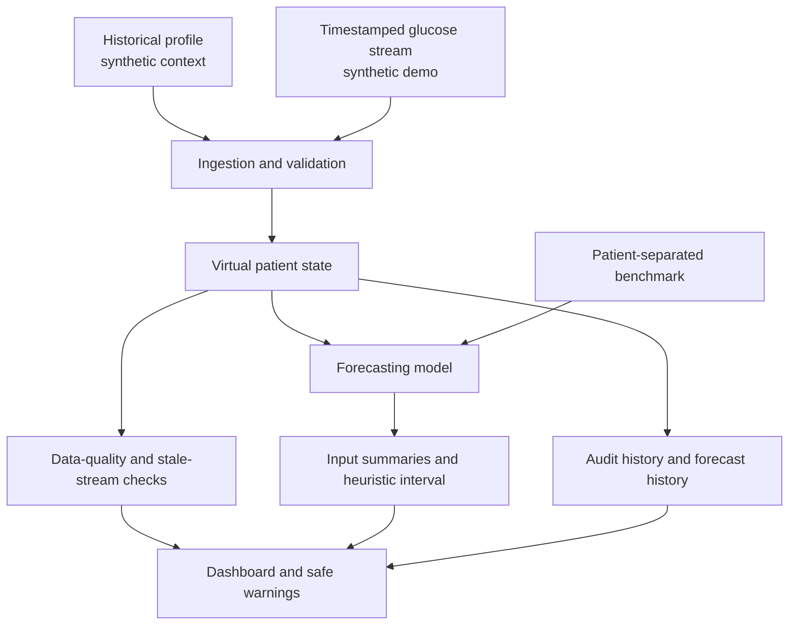

# GlucoTwin: An Explainable, Personalized Glucose Digital Twin

**Digital Twin Challenge 2026 · student proof of concept · synthetic data only**

> **Safety:** GlucoTwin is an educational research prototype. It is not clinically validated and must not be used to diagnose, treat, make insulin/medication decisions, or replace professional medical judgment. Forecasts may be wrong. The included patient and glucose data are synthetic.

## Team and submission details

- **Team:** `[Add team name and member names]`
- **College/incubator:** `[Add verified institution/incubator details]`
- **Team leader:** `[Complete privately on the official submission platform; do not commit phone/email here]`
- **Demo video (20 minutes minimum):** `[Add public/unlisted video URL after recording and access-checking]`
- **Public repository:** `[Add repository URL after publishing]`

These placeholders are intentional; team details and a recorded video were not supplied and are not fabricated.

## Problem and use case

Glucose values change between clinical visits. A single reading or static history does not show short-term trajectory. GlucoTwin demonstrates how historical patient context and a dynamic glucose stream can be joined into an auditable virtual state, then used to forecast future glucose and communicate data quality, model limitations, and hypothetical scenarios to a clinician/researcher. The task is glucose forecasting, not diagnosis or treatment selection.

## Implemented capabilities

- Synthetic historical profile plus timestamped glucose observations, with explicit provenance.
- Virtual patient state that updates on accepted new readings.
- Validation for malformed timestamps, unsupported values, duplicate timestamps, and out-of-order observations.
- Staleness, low-observation-count and gap warnings.
- Recursive next-step forecasting with a HistGradientBoostingRegressor model trained on synthetic sequences.
- Persistence baseline and a fixed-seed, patient-separated synthetic benchmark at a 30-minute target horizon.
- Descriptive input summaries (recent level, short-term slope, recent variability); these are not causal explanations or SHAP attributions.
- An illustrative residual-based uncertainty band. It is not calibrated for clinical use and widens heuristically with forecast horizon.
- What-if perturbation of recent glucose inputs, explicitly labeled hypothetical and non-causal.
- Session audit events and append-only local JSONL audit output.
- Streamlit dashboard and automated tests.

### Important implementation boundary

Historical fields are represented in the state and are included as static model features (age, diabetes duration, HbA1c) alongside glucose lags and time-of-day features. The current benchmark does not isolate the incremental contribution of the static fields, and their synthetic associations are not clinical evidence. The synthetic sample profile is not a Synthea export. No live device, clinician system, or real patient record is connected.

## Architecture



See `docs/architecture.pdf` and `docs/architecture.pptx`.

## Research context and technical gaps

This is an integration-focused PoC, not a claim to invent digital twins or glucose prediction. The current Unstop challenge listing describes fusion of historical EHR context and dynamic sensor streams and requires a public repository plus architecture and presentation files; it currently lists the prototype submission deadline as 20 October 2026 at 7:00 PM IST. Confirm details on the official listing before submission: https://unstop.com/hackathons/digital-twin-challenge-2026-happiest-health-1757873. The targeted research and challenge-verification notes, including links and dataset caveats, are in `docs/research_notes.md`. A 2024 scoping review notes healthcare digital twins are an emerging field and highlights data interoperability, privacy/security and the need for patient-specific, evolving representations. A 2025 meta-review identifies data quality, ethics, scalability, interoperability and clinical validation as ongoing barriers. Those findings motivate provenance labels, quality gates, audit history and conservative claims in this project.

- Katsoulakis et al. *Digital twins for health: a scoping review*. npj Digital Medicine 7, 77 (2024). https://doi.org/10.1038/s41746-024-01073-0 (open access CC BY 4.0 per article).
- Ringeval et al. *Advancing Health Care With Digital Twins: Meta-Review of Applications and Implementation Challenges*. Journal of Medical Internet Research 27, e69544 (2025). https://doi.org/10.2196/69544.
- Prioleau et al. *DiaTrend: A dataset from advanced diabetes technology to enable development of novel analytic solutions*. Scientific Data 10, 556 (2023). https://doi.org/10.1038/s41597-023-02469-5. The dataset is a potential next step, but no dataset access or data-file license was assumed here.
- Synthea synthetic patient generator: https://github.com/synthetichealth/synthea.
- Twin Health commercial personalized metabolic-health offering: https://www.twinhealth.com/ (commercial product example; not independently benchmarked here).

**Opportunity for future research:** test on an authorized real CGM dataset, evaluate patient-specific adaptation, calibrate prediction intervals on validation data, test robustness to missingness and drift, and obtain clinical review. None of these should be represented as completed or clinically validated in this version.

## Requirements

Python 3.10+ recommended. Dependencies are listed in `requirements.txt`.

### Setup (Windows PowerShell)

```powershell
cd GlucoTwin
py -m venv .venv
.\.venv\Scripts\Activate.ps1
python -m pip install --upgrade pip
pip install -r requirements.txt
python scripts/generate_synthetic_data.py
```

### Setup (macOS/Linux)

```bash
cd GlucoTwin
python3 -m venv .venv
source .venv/bin/activate
python -m pip install --upgrade pip
pip install -r requirements.txt
python scripts/generate_synthetic_data.py
```

### Run the dashboard

```bash
streamlit run app/dashboard.py
```

The app trains/caches a small model from deterministic synthetic sequences on first use. Use **Generate / refresh forecast**, inject a later timestamped reading, then generate a fresh forecast. To test stale behavior, stop adding readings or use the quality unit tests; the demo UI avoids requiring a real device connection.

### Run tests

```bash
pytest -q
```

### Reproduce benchmark

```bash
python scripts/evaluate.py
```

This writes `experiments/benchmark_report.json` and `.md` with actual computed results. Metrics may vary with dependency versions; the seed and split are fixed. The benchmark is synthetic-only and does not establish clinical performance.

### Optional model artifact and stream replay

```bash
python scripts/train.py
python scripts/replay_stream.py
```

`train.py` writes a local joblib model artifact which is ignored by git. `replay_stream.py` demonstrates an observation update and writes a local audit log.

## Evaluation protocol

- 5-minute synthetic observations; input is the previous 12 readings (60 minutes).
- Target: glucose 30 minutes after the final input reading.
- Split: 18 training synthetic patient IDs and 6 held-out synthetic patient IDs, no ID overlap.
- Models: persistence (last observed value) and `HistGradientBoostingRegressor`.
- Both models are scored on the same held-out target windows.
- Metrics: MAE, RMSE and R². See `experiments/benchmark_report.md` for measured numbers and caveats.
- No final test-set tuning was intentionally performed; this is a small engineering benchmark, not a clinical study.

## Uncertainty, explanations and scenario limits

The dashboard’s shaded range is a heuristic band based on in-sample training residuals, not a formally calibrated prediction interval. The explanation panel reports observable input summaries and avoids implying causal attribution. The what-if tool perturbs recent glucose values and shows the model response; it does not model a meal, medication, insulin, or any real intervention. It must not be interpreted as a treatment effect.

## Tests and status

Automated tests cover deterministic synthetic data, state update, duplicate/invalid/out-of-order rejection, stale/insufficient data warnings, feature construction, metrics, forecast structure and explicit failure when the model is untrained. Actual run results are recorded in `experiments/verification_report.md`. Streamlit was not installed in the execution container, so the interactive UI has not been smoke-tested here; it is included in requirements.txt.

## License

Source code: MIT License, see `LICENSE`. The MIT license does not grant rights to third-party datasets or cited publications. Data provenance and access notes are in `data/README.md`.

## Remaining submission checklist

- [ ] Replace team/institution placeholders with verified details.
- [ ] Publish repository and test public access.
- [ ] Record and publish an at-least-20-minute demo video; test link in a private/incognito browser.
- [ ] Confirm official challenge deadline, eligibility and exact submission form requirements against the official challenge page.
- [ ] Have a qualified clinician/research mentor review the framing and limitations.
- [ ] If adding DiaTrend or any other real dataset, verify access, data terms, data dictionary, population, preprocessing and redistribution rights before training or publishing.
- [ ] Capture real application screenshots and refresh presentation outcomes after the final run.

## Demo-video plan (20:30+)

1. **00:00–02:00:** Problem, target outcome and research-only disclaimer.
2. **02:00–05:00:** Existing digital-twin literature and limitations.
3. **05:00–08:00:** Architecture, synthetic provenance, and dataset decision.
4. **08:00–12:00:** Open `SYNTH-001`, inspect context and chart, generate forecast, inject new observation, show state update and forecast refresh.
5. **12:00–14:00:** Invalid/duplicate/stale data behavior and hypothetical scenario lab.
6. **14:00–17:00:** Run tests and benchmark; show baseline comparison and failures/limitations.
7. **17:00–19:00:** Privacy, uncertainty, non-causal interpretation and lack of clinical validation.
8. **19:00–20:30+:** Repository, installation, commands, documentation and remaining work.

