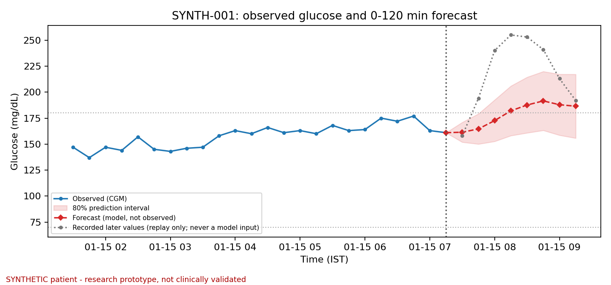
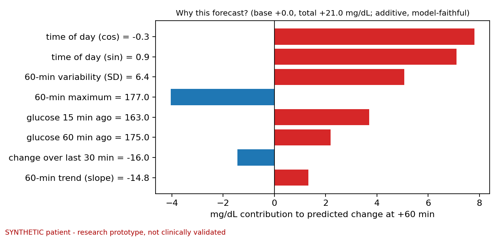
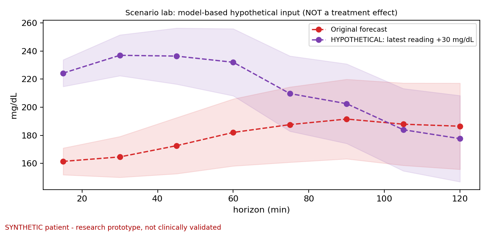
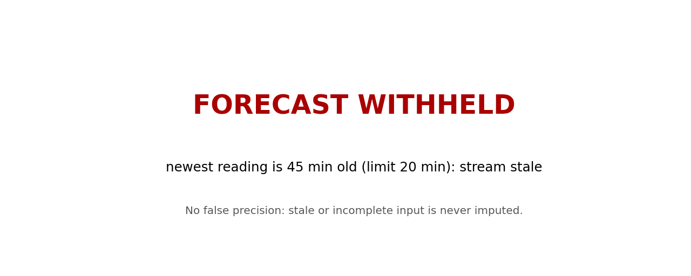
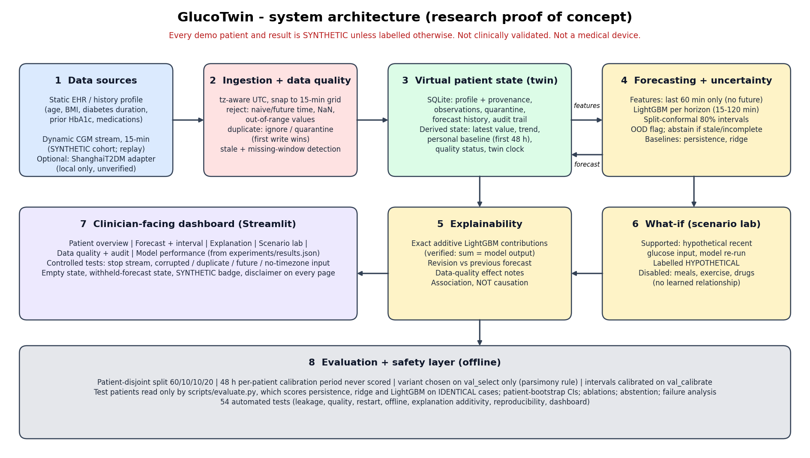

# GlucoTwin - an explainable, personalized glucose Digital Twin (research proof of concept)

> **Safety disclaimer.** GlucoTwin is an educational research proof of concept. It is not clinically validated and must not be used to diagnose, treat, or make medication decisions. All demonstration patient records are synthetic unless explicitly identified otherwise. Forecasts may be wrong, and the prototype is not a substitute for professional medical judgment.
>
> **Every result in this repository comes from SYNTHETIC data.** It shows that the pipeline works and how the models compare *on the synthetic generator*. It says nothing about real patients, about type 2 diabetes in India, or about clinical usefulness.

## Challenge checklist (Digital Twin Challenge 2026)

| # | Item | Status |
|---|---|---|
| 1 | Team details | **[TEAM NAME, MEMBERS, ROLES - to be filled by the team]** |
| 2 | College / incubator | **[COLLEGE / INCUBATOR - to be filled]** |
| 3 | Project title | GlucoTwin: an explainable, personalized glucose Digital Twin (*name provisional, see Known issues*) |
| 4 | Problem statement | See [Problem statement](#problem-statement) |
| 5 | Healthcare use case | See [Healthcare use case](#healthcare-use-case) |
| 6 | Technical stack | See [Technical stack](#technical-stack) |
| 7 | AI/ML model details | See [Model](#model) |
| 8 | Public demo video (>= 20 min) | **[DEMO VIDEO URL - not yet recorded; plan in [`docs/DEMO_VIDEO_PLAN.md`](docs/DEMO_VIDEO_PLAN.md)]** |
| 9 | Open-source licence | MIT - [`LICENSE`](LICENSE); third-party notices in [`THIRD_PARTY_NOTICES.md`](THIRD_PARTY_NOTICES.md) |
| 10 | Architecture diagram (PDF) | [`docs/architecture.pdf`](docs/architecture.pdf) |
| 11 | Presentation (PDF/PPT) | [`docs/presentation.pdf`](docs/presentation.pdf) / [`docs/presentation.pptx`](docs/presentation.pptx) |
| 12 | Files and links publicly accessible | **[TO CONFIRM after the repository is made public]**; remaining items in [`docs/SUBMISSION_CHECKLIST.md`](docs/SUBMISSION_CHECKLIST.md) |

## Problem statement
Clinicians see a person's diabetes through sparse snapshots (visits, lab values), while a continuous glucose monitor (CGM) produces a reading every few minutes. GlucoTwin asks: can a **virtual patient state** that fuses historical (EHR-style) information with the live CGM stream, and updates with every new reading, support a **0-120 minute glucose forecast** that is explainable, comes with honest uncertainty, and refuses to answer when its input is unreliable?

## Healthcare use case
Type 2 diabetes review support: a clinician-facing view of where a patient's glucose is heading, why the model thinks so, how reliable the input is, and how the forecast reacts to hypothetical changes in recent readings. Context: the ICMR-INDIAB study estimated about 101 million people with diabetes (11.4%) and 136 million with prediabetes (15.3%) in India (Anjana et al., *Lancet Diabetes Endocrinol* 2023; figures as reported by secondary coverage - verify against the paper). **Usefulness is a motivation here, not something this project demonstrates.**

## Features
* **Data fusion**: static profile with per-field provenance + 15-minute CGM stream -> one persisted twin state (SQLite) that survives restarts.
* **Continuous update loop**: validate -> quarantine or append -> quality check -> forecast or withhold -> explain -> audit (every step logged).
* **Forecasts** for 15-120 minutes with 80% split-conformal intervals; every forecast stores its origin, model version and inputs; previous forecasts are kept and compared.
* **Data-quality behaviour**: rejects naive/future timestamps, NaN, non-numeric and out-of-range values; ignores identical duplicates; quarantines conflicting duplicates; withholds the forecast when the stream is stale (> 20 min) or the 60-min window is incomplete (no imputation); flags out-of-distribution input.
* **Explanations**: exact additive LightGBM feature contributions (sum verified against the model output) with stated causal limits.
* **Scenario lab**: model-based hypothetical changes to recent glucose, clearly labelled; meal/exercise/medication controls disabled because the model has no such inputs.
* **Dashboard** (Streamlit): overview, forecast, explanation, scenario lab, quality + audit, model performance; empty state; SYNTHETIC badge and disclaimer always visible.
* **Rigorous evaluation**: patient-disjoint splits, per-patient calibration period, baselines on identical cases, patient-bootstrap CIs, ablations (reported even when negative), abstention accounting, failure analysis.

### Screenshots
Real browser screenshots are **TODO** (the build environment had no browser) - see [`docs/demo_screenshots/README.md`](docs/demo_screenshots/README.md). Renders of the same engine outputs (matplotlib, SYNTHETIC patient SYNTH-001):

| Forecast (an honest miss: the breakfast spike escapes the interval) | Explanation |
|---|---|
|  |  |
| **Scenario lab** | **Forecast withheld (stream stopped)** |
|  |  |

## Architecture and data flow


```
history profile ─┐                                   ┌─> forecast (15..120 min) + 80% interval ─┐
                 ├─> validate/quarantine ─> twin ────┤                                          ├─> dashboard
CGM stream ──────┘   (quality gate)        state    └─> explanation, revision, audit trail ────┘
                                         (SQLite)        └─> scenario lab (HYPOTHETICAL)
```
Package layout (`glucotwin/`): `ingestion/` (loaders, ShanghaiT2DM adapter), `data_quality/` (validation, staleness), `digital_twin/` (store, engine, demo replay), `forecasting/` (features, models, pipeline), `explainability/`, `evaluation/` (protocol, metrics), `synthetic/` (generator). Entry points are in `scripts/` and `app/`.

## Data sources, licences and the synthetic-vs-real boundary
Full details: [`data/README.md`](data/README.md). Summary:

| Data | Real or synthetic | Used here? | Terms |
|---|---|---|---|
| Synthetic cohort (100 patients x 14 days) and 3-patient demo sample | **SYNTHETIC** | Yes, for all results and the demo | MIT (generated by this code) |
| ShanghaiT2DM (type 2, real) | Real | **No** (optional local adapter, untested on real files) | Public on figshare; **licence unverified**, sources conflict; not redistributed |
| DiaTrend (type 1, real) | Real | **No** | Controlled access (Synapse + agreement); no redistribution |

The synthetic generator builds in meal schedules and a profile-to-glucose link, so gains from time-of-day or static EHR features on this data are **artifacts, not findings**. Type 1 results would not establish type 2 performance either.

## Technical stack
Python 3.12; pandas, NumPy, scikit-learn, LightGBM, joblib; SQLite (standard library); Streamlit + Plotly (dashboard); matplotlib (figures); pytest. Deck built with pptxgenjs (dev only). Pinned versions: [`requirements.txt`](requirements.txt).

## Model
* **Task**: input = last 5 CGM readings (60 min, 15-min grid) [+ time of day]; output = glucose at +15, +30, ..., +120 min.
* **Baselines**: persistence (last value); ridge regression on the same features.
* **Primary**: LightGBM, one model per horizon, predicting the *change* from the latest reading; fixed hyper-parameters (`glucotwin/config.py`). Feature variants tested: CGM-only, + time of day, + personal baseline (first 48 h), + static EHR fields. The variant is chosen **on validation patients only** by a pre-declared parsimony rule (simplest variant within 1% of the best validation MAE) -> currently `cgm_tod`.
* **Uncertainty**: symmetric split-conformal intervals (80% nominal) calibrated on separate calibration patients; constant width per horizon; marginal (not per-patient) guarantee.
* **Leakage controls**: patient-disjoint splits (60/10/10/20), first 48 h per patient never scored, scaler fit on train only, test patients touched only by `scripts/evaluate.py` with frozen models.

## Setup
```bash
git clone <YOUR REPO URL> GlucoTwin && cd GlucoTwin
python3 -m venv .venv && source .venv/bin/activate        # Windows: .venv\Scripts\activate
pip install -r requirements.txt
```

## Run the dashboard (works immediately: sample data and a trained model are committed)
```bash
python scripts/init_demo.py --reset        # creates data/runtime/glucotwin.sqlite with 3 SYNTHETIC patients
streamlit run app/dashboard.py
```
(If the database does not exist the app shows an empty state with an "Initialise SYNTHETIC demo patients" button.)

## Replay a sample stream
```bash
python scripts/replay_stream.py --patient SYNTH-001 --steps 12                    # each new reading updates state + forecast
python scripts/replay_stream.py --patient SYNTH-001 --steps 12 --stop-after 6     # stream stops -> forecast withheld (stale)
```
In the dashboard use the sidebar: **+15 min / +1 h** replays the recorded synthetic stream (no live device exists); the "Controlled data-quality tests" buttons inject a stopped stream, corrupted value, future timestamp, missing time zone and conflicting duplicate.

## Train and evaluate (reproduces every number below; about 2 minutes)
```bash
python scripts/generate_synthetic_data.py     # data/generated/ (git-ignored) + data/sample_synthetic/
python scripts/train.py                       # models/glucotwin_model.joblib, models/ablations/, experiments/model_selection.json
python scripts/evaluate.py                    # experiments/results.json, experiments/benchmark_report.md, docs/figures/*.png
```
`make all` runs data -> train -> evaluate -> demo -> test. Re-running gives bit-identical metrics (checked).

## Actual benchmark results (SYNTHETIC test patients)
<!-- RESULTS:START -->
| Horizon (min) | Persistence MAE | Ridge MAE | LightGBM CGM-only MAE | **Primary** (`cgm_tod`) MAE | 80% interval coverage |
|---|---|---|---|---|---|
| 15 | 9.45 | 7.97 | 6.87 | **6.79** | 0.784 |
| 30 | 15.52 | 12.48 | 11.05 | **10.92** | 0.790 |
| 45 | 21.00 | 16.65 | 15.54 | **14.62** | 0.796 |
| 60 | 25.64 | 20.08 | 19.30 | **17.20** | 0.795 |
| 90 | 32.14 | 24.16 | 23.66 | **19.60** | 0.794 |
| 120 | 35.27 | 25.50 | 24.85 | **20.55** | 0.796 |

MAE in mg/dL on **20 held-out SYNTHETIC test patients**, 20,825 scored windows, identical cases for all models. Data source(s): SYNTHETIC; data fingerprint `2a4bb446604a39157250b007e55b3928`; model `glucotwin-lgbm-cgm_tod-b09655ec`.

- Primary vs persistence at +60 min: -8.44 mg/dL (95% patient-bootstrap CI -11.12 to -6.24); better for 20 of 20 patients.
- Abstention (incomplete 60-min window): 6.4% of observed origins; out-of-distribution qualified: 1.12%.
- Hyperglycaemia-onset event task (>180 mg/dL within 2 h): primary F1 0.688 (precision 0.608, recall 0.791); persistence recall 0 by construction.
- Full tables, ablations, per-patient results and failure analysis: [`experiments/benchmark_report.md`](experiments/benchmark_report.md).
<!-- RESULTS:END -->

**Read this correctly.** The time-of-day gain is expected by construction (scheduled synthetic meals): the CGM-only LightGBM is only slightly better than ridge at +120 min. The personal-baseline variant gave only a tiny gain at +15 min (about 0.3 mg/dL; CI excludes zero) and no reliable gain from +30 min onward; static EHR fields gave no reliable gain at any horizon (CIs include zero). Interval coverage varies by patient. None of this transfers to real patients without real-data validation.

## Tests
```bash
python -m pytest -q
```
**Last run: 54 passed** (in the working tree and in a fresh virtualenv installed only from `requirements.txt`). Coverage of the spec's DT-001..DT-018 scenarios: profile load, state update on new reading, duplicates, invalid input, missing/stale data, forecast structure, withheld forecasts, scenario separation, evaluation on identical cases, reproducibility, empty state, restart persistence, offline operation, leakage controls, explanation additivity, source labelling, and the dashboard via Streamlit's `AppTest`. As a sanity check, deliberately breaking the leakage, validation and staleness rules made the corresponding tests fail. Not tested: the real-data adapter on real files, the dashboard in a real browser.

## Known limitations
* Synthetic data only; no clinical validation; population claims (type 2, India) are not supported.
* Meals, exercise and medication are not modelled; the hardest cases are unannounced meal spikes (see the failure analysis).
* Fixed 60-min window and 120-min horizon (initial choices, not shown optimal); one 14-day record per patient; one split seed.
* Intervals are marginal and non-adaptive; some patients are under-covered.
* The ShanghaiT2DM adapter encodes unverified assumptions (layout, units, time zone) and the dataset licence is unverified.
* Dashboard replays a recorded stream; there is no device integration, authentication or privacy/regulatory hardening.

## Documentation map
[`docs/RESEARCH.md`](docs/RESEARCH.md) (what was verified and what was not) · [`data/README.md`](data/README.md) · [`models/README.md`](models/README.md) · [`experiments/benchmark_report.md`](experiments/benchmark_report.md) · [`docs/DEMO_VIDEO_PLAN.md`](docs/DEMO_VIDEO_PLAN.md) · [`docs/SUBMISSION_CHECKLIST.md`](docs/SUBMISSION_CHECKLIST.md)

## Team contributions
**Jidnyasa Patil - Research , model and integration**
**Sajiree Damle - Full stack development and deployment**

## Licence
MIT (code and synthetic sample data). Third-party packages and datasets: [`THIRD_PARTY_NOTICES.md`](THIRD_PARTY_NOTICES.md).
